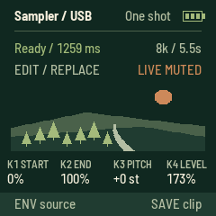
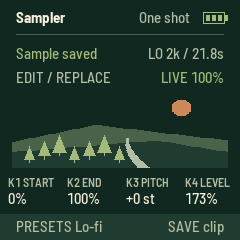
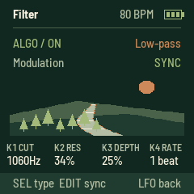
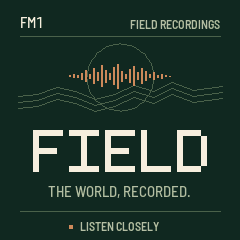

# FIELD

An independent field-recording radio for the **M-VAVE FM-1**, powered by Radio Aporee.
Browse the world, choose a country or state/province, and listen through a static globe UI.

**[Open the website](https://aveycole.github.io/FM1-Field/) ·
[USB web installer](https://aveycole.github.io/FM1-Field/install/) ·
[Download 0.1.18-alpha](docs/firmware/field-0.1.18-alpha.fwsc)**

## Status

This is experimental firmware. The original alpha was reported working on an FM-1,
and the playback-buffer update was reported to improve cutouts substantially.
0.1.18 adds USB audio sampling. In the sampler, press ENV to choose Radio or USB; the header identifies USB. On your computer, choose FIELD as the audio output at 44.1 kHz, 16-bit stereo, then play audio and press REC. Incoming stereo is captured as mono. USB works with Replace, Layer overdubs, all four quality settings and SAVE. SELECT sets live mix and ALGORITHM mutes monitoring without stopping capture. Source changes are locked during recording; leaving the editor restores radio monitoring. The display mirror and existing sample/stream buffers remain. Software tests pass; physical-device USB testing is still needed.

For installation, leave FIELD running normally; the web installer switches modes
automatically. It also accepts a loader already on screen. Allow up to 45 seconds
for discovery. The new loader re-enumerates USB after 12 idle seconds if necessary,
with no reconnects during an active flash session. An older loader already running
uses its old behavior until this release is staged from running firmware.

The header shows a three-bar battery level, or `USB` when powered by an active USB host.

## Controls

| Control | Action |
| --- | --- |
| OCT− / OCT+ | Another recording from any page; ARP retains octave transposition and WiFi typing retains character layers |
| REC | Save a favorite outside the sampler; capture in ARP / ENV; remove in the favorites list |
| SEQ | Open favorites; press again to return |
| SAVE | In ARP: save/replace one persistent clip. On the player: browse regions. On GLO: refresh cached locations |
| SELECT / SEL | Move / open in the browser; player shows credits; sampler cycles playback modes |
| PLAY | Play / stop; start the highlighted region or favorite |
| HOME | Up in the browser; worldwide random from the regional player |
| GLO | WiFi setup (2.4 GHz) |
| MASTER | Volume |
| Keys | Play the captured sample on the player and in ARP; ENV opens the same sample editor |
| ARP | Sample editor: REC capture, PLAY audition, SEL cycles one shot / loop hold / loop latch / slice; K1 start, K2 end, K3 pitch, K4 level |
| PRESETS in ARP, outside Slice | Choose the next capture rate: 16 / 8 / 4 / 2 kHz, up to 2.7 / 5.5 / 10.9 / 21.8 seconds |
| PRESETS in ARP Slice | Select 4, 8, 16 or 27 equal slices of the trimmed clip; fewer slices are longer |
| LFO | Open the filter page; press again or HOME to return to the player |
| SELECT in ARP | Continuous live monitor mix, 0–100%; K4 independently sets sample level, 0–200% |
| ALGORITHM in ARP | Left mutes the live monitor; right restores it. Samples and capture remain available |
| FX | Tap tempo for the retained LFO filter |
| PRESETS on LFO | Set BPM, 40–240; header displays it |
| ENV | Outside sampler: open editor. Inside sampler: toggle Radio / USB source while stopped; preserves the clip |
| EDIT | Player: toggle Near. ARP: switch REPLACE / LAYER recording while stopped |

In favorites, turn SELECT to move, then press SEL or PLAY to replay that exact recording.
Favorites survive power-off. Up to 16 fit in a separate 3,840-byte flash object; long
URLs and credits can fill it sooner. A full list asks you to remove an entry.
These are online bookmarks: playback still requires WiFi and the recording to remain available.

The sampler holds one **mono ADPCM clip** (one playback voice) in a 24 KiB bank reclaimed from the removed effects.
It survives returning to the main screen, changing recordings, and reopening ARP.
REC again stops capture early; otherwise it stops at capacity. ARP's OCT buttons
transpose; keys use C4 as the original pitch. In Loop hold, releasing the triggering key stops playback. Loop latch keeps
playing after release and across screens; tap its key again or PLAY in ARP to stop.
Slice divides the trimmed range into 4, 8, 16 or 27 equal sections at a common
pitch. PRESETS selects the count while in Slice mode; higher keys repeat the
sequence when fewer than 27 slices are selected. It starts at 27 on boot.
Changing the count stops the current sample voice and retains the clip.
SEL cycles One shot → Loop hold → Loop latch → Slice → One shot. PLAY auditions/stops the clip. Leaving the sampler finishes capture without saving it.
The selected live input stays audible in ARP by default. Turn ALGORITHM left to mute
its monitor and right to restore it at the chosen SELECT mix. This switch does not mute the sample or
stop capture. A short fade avoids an abrupt gain change. Leaving the editor restores full live playback; the editor remembers its mix and mute until reboot.

To capture **USB-C audio**, connect FIELD to a computer with a data cable and select **FIELD as the computer’s playback/output device** at **44.1 kHz, 16-bit stereo**. This uses USB device audio, not a USB-host connection to another USB peripheral. Send audio from the computer, open **ARP**, and press **ENV** until the header says **Sampler / USB**. Press **REC** to capture or **EDIT** for Layer, then REC to overdub. Stereo input is averaged to mono in the existing sample bank.

USB capture works without WiFi. Incoming silence records normally; missing USB frames pause capture. The editor reports when USB audio is unavailable and refuses an empty start. Monitoring mix/mute does not affect capture. Source selection is locked while recording; stop with REC or SAVE before switching. Leaving the editor finishes capture and restores radio monitoring; the same sample remains playable on the keyboard. Source selection resets to Radio at boot; saved clips keep their audio and rate regardless of origin.

The USB receive ring adds 2 KiB of heap, reserved before WiFi allocations. No sample, compressed-stream or PCM buffer is reduced. The optional USB display mirror remains available with its existing low-memory guard. The computer can still record FIELD’s output over USB; avoid routing that return back into FIELD unless an audio feedback loop is intended.



Press **SAVE in ARP** to store one clip, including trim, pitch/octave, level,
playback mode, slice count and recorded rate. SAVE during capture finishes it early and saves.
The display confirms “Sample saved.” Another SAVE replaces this single slot.
New captures and edits are temporary until saved. The saved clip restores at
boot and when the editor is reopened with no clip. Previous saved clips migrate when saved again; both sample banks commit only after payload verification. New expanded clips require 0.1.17 or later.
Saving briefly interrupts audio while the flash is programmed. Failed writes
retain the previous saved version. Normal FIELD updates preserve the slot;
restoring other firmware or erasing user data can overwrite it.

Turn **PRESETS in ARP outside Slice mode**, before recording in REPLACE,
to select quality/time. Turn right for more Lo-fi; left selects higher quality.

| Recording rate | Capacity | Sound |
| --- | --- | --- |
| 16 kHz | 2.728 seconds | Highest available bandwidth |
| 8 kHz | 5.456 seconds | Default |
| Lo-fi 4 kHz | 10.912 seconds | Less high-frequency detail |
| Lo-fi 2 kHz | 21.824 seconds | Strong Lo-fi character |

The right side of the status row shows the selected rate/capacity; Ready shows
the current clip's actual length. Changing PRESETS does not stretch or retune
an existing sample: the setting applies to the next new capture. It cannot
change during recording. Slice mode retains PRESETS for slice count; press
SEL to leave Slice before selecting recording quality.

Overdubs use the existing clip's rate and duration. In LAYER with a clip,
PRESETS reports “Layer uses clip rate”; use REPLACE to choose a new rate.
SAVE stores the actual captured rate, and it restores on reboot at normal
pitch. Existing 8 kHz saved clips remain compatible. New clips need FIELD 0.1.17 or later. Existing clips retain their recorded rate and pitch.



Press **EDIT in ARP** to select **LAYER**, then **REC** to overdub the live
recording onto the existing clip. It makes one pass over the full original
clip at its original speed, with a 50/50 blend for headroom. The old clip is
audible during the pass; keyboard audition resumes afterward. Trim, pitch,
octave, slice and playback settings are retained. The clip's length stays the
same at its recorded rate. Network buffering pauses capture.

REC again stops early and leaves the remaining old audio intact. SAVE stops
capture and stores the merged result in the existing single saved slot.
**EDIT** switches back to **REPLACE** for a new recording; it defaults to Replace
after reboot. If no clip exists, Layer makes a normal first capture. A layer
is temporary until saved. The LFO filter remains available and is not baked into capture.


The sampler uses a static landscape with compact knob readouts and no keyboard activity display. SELECT sets live mix; ALGORITHM mutes independently. Sample playback gain now reaches 200%, with a default of 173%. Overall output gains 1.5× before the master control, with stereo-linked peak limiting. Capture stays dry and unboosted for overdub headroom. This increases digital level, not the amplifier's physical maximum. Tap FX to set filter tempo; the player briefly displays BPM and the FX LED pulses on the beat.

[USB live display](https://aveycole.github.io/FM1-Field/mirror/) mirrors the
240×240 screen in desktop Chrome or Edge. Connect with FIELD running normally.
Move the computer window to a monitor or capture it in OBS; fullscreen and PNG
save are provided. This is a read-only USB-MIDI pixel stream, not HDMI,
DisplayPort or a UVC webcam. No direct USB-C monitor connection is supported.
Its 3,928-byte heap object exists only while subscribed; at least 8 KiB of heap
reserve must remain. Disconnect, cable removal or a six-second missing
heartbeat releases it. The installer asks this site’s viewer to close its
ports before taking USB ownership. Compressed audio and PCM buffers retain
their previous sizes.


LFO opens an independent stereo filter after the live/sample mix. The filter
starts off at boot and activates on its first visit; it stays active when leaving
the page. ALGORITHM left bypasses it, right enables it. Its state is temporary.
K1 sets cutoff (80–6,000 Hz), K2 resonance, K3 modulation depth (zero gives a
manual filter), and K4/SELECT speed. SEL cycles low-pass, high-pass, band-pass.
EDIT toggles free speed (0.05–8 Hz) / sync (8, 4, 2, 1, 1/2, 1/4 beats per cycle).
FX on this page enables sync and taps tempo; other FX taps update the shared
tempo too. The header shows BPM. The static river scene and compact readouts
match the sampler. Filter bypass and cutoff/resonance changes are smoothed.
Samples remain playable on this page; OCT skips within the current region,
REC saves favorites, ARP opens the sampler, ENV opens the same sampler editor.
Capture remains before the filter, so the captured source stays dry. The filter
needs a small amount of state and uses no sample audio history.



Delay/Reverb and the old held-key effects are removed in this sampler-focused build. Their memory now belongs to the longer clip. Pitch-independent time-stretch is not implemented; the pitch knob still changes playback speed and pitch together.

Near is anchored when EDIT enables it and survives power-off. It does not drift
with each skip. An uncached Near anchor scans the location index once, potentially taking three minutes or longer; later skips and reboots reuse its saved cache. EDIT disables it;
choosing a region or worldwide random from SAVE also disables it. It never widens
the radius silently if no locations match.



The first uncached location selection downloads Aporee's index and takes about three minutes, longer on a weak connection. FIELD saves a 32-location reservoir per cached world/region/Near context in eight rotating flash sectors. Later boots and exhausted batches reuse those locations and fetch only their playlists; recordings remain online. The worldwide cache is retained when other contexts rotate out. An uncached or evicted context requires another scan.

Press **GLO → SAVE** to scan again and replace the current context's cached locations. This is a bounded location reservoir, not the full world index: without refresh, location diversity is limited to its saved batch. New recordings at those locations can still be selected. Writes occur only for a changed batch, with CRC validation and commit last; interrupted refreshes retain the previous saved copy.

The catalogue contains **162 countries and 1,560 states/provinces** with recordings.
It uses a snapshot of Aporee coordinates and generalized Natural Earth boundaries.
Offshore/unclassified points and newly added locations remain available worldwide.
It is a browsing aid, not a precise border map. See [full notes and limitations](APOREE.md).

The device screen and USB product name are **FIELD**.

## Build

The platform is vendored in `base/`; no submodule setup is needed.
Use Linux x86-64, Python with Pillow, JieLi's pi32v2 toolchain, and AC79 SDK
`AC79NN_SDK_V1.2.1_2023-12-13`. SDK binaries are not vendored.

```sh
python3 -m pip install Pillow
AC79_SDK=/path/to/fw-AC79_AIoT_SDK JIELI_TOOLCHAIN=/path/to/toolchain \
  python3 base/tools/build.py app --release 0.1.18-alpha
```

This produces `app/build/field-0.1.18-alpha.fwsc`. Platform setup is documented
in [the upstream README](UPSTREAM-README.md) and [base](base/README.md).
The generated region catalogue is included; Shapely/NumPy and the boundary source
are needed only when rebuilding that catalogue.

## Validation

- Hardware build checks: image, RAM, pool headroom and register access.
- Every compressed geographical lookup compared with the generated mapping.
- Country/state filtering, one-location regions, and worldwide-cache restoration.
- Simulator menu navigation, playback completion, and controls.
- Simulated 1.5-second network pauses at 128/320 kbps without rebuffering;
  a seven-second pause causes one refill and resumes the same recording.

See [APOREE.md](APOREE.md) and `tests/` for details. Software tests do not establish
real-world WiFi reliability on every FM-1.

## Website

The main page flashes directly in place, with an inline confirmation and progress display. Recovery and crash-report tools are below it. The complete static landing page and USB flasher live in `docs/`. GitHub Pages
publishes `main` → `/docs`. All links are relative so the site works under this
repository's Pages path. Firmware downloads, checksums, and previous alphas are included.

## Credits and licences

Built on [fm1-radio](https://github.com/charlesvestal/fm1-radio) by Charles Vestal,
[fm1-base](https://github.com/charlesvestal/fm1-base), and
[felucca-bsp](https://github.com/hugelton/felucca-bsp), from Felucca by
Leo Kuroshita (Hügelton Instruments). See [source provenance](PROVENANCE.md).
Source is MPL-2.0 with third-party components under their own licences;
all notices are retained in [LICENSING.md](LICENSING.md) and `LICENSES/`.

Recordings come from [Radio Aporee](https://aporee.org/maps/) and retain their
contributors' individual licences. Geography is made with Natural Earth (public domain).
FIELD is independent of, and not endorsed by, Radio Aporee or M-VAVE.
