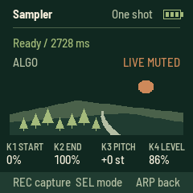
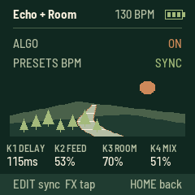

# FIELD

An independent field-recording radio for the **M-VAVE FM-1**, powered by Radio Aporee.
Browse the world, choose a country or state/province, and listen through a static globe UI.

**[Open the website](https://aveycole.github.io/FM1-Field/) ·
[USB web installer](https://aveycole.github.io/FM1-Field/install/) ·
[Download 0.1.13-alpha](docs/firmware/field-0.1.13-alpha.fwsc)**

## Status

This is experimental firmware. The original alpha was reported working on an FM-1,
and the playback-buffer update was reported to improve cutouts substantially.
The 0.1.13 update restores contrast on WiFi password keyboard labels, including capitals, symbols and pressed keys. Sampler delay/reverb and its FX hold shortcut remain available. Simulator screens have been checked; physical-device testing is still needed.

For installation, leave FIELD running normally; the web installer switches modes
automatically. It also accepts a loader already on screen. Allow up to 45 seconds
for discovery. The new loader re-enumerates USB after 12 idle seconds if necessary,
with no reconnects during an active flash session. An older loader already running
uses its old behavior until this release is staged from running firmware.

The header shows a three-bar battery level, or `USB` when powered by an active USB host.

## Controls

| Control | Action |
| --- | --- |
| OCT− / OCT+ | Another recording from any page; ARP retains octave transposition and WiFi typing retains character layers |
| REC | Save a favorite on the player / ENV; capture in ARP; remove in the favorites list |
| SEQ | Open favorites; press again to return |
| SAVE | In ARP: save/replace one persistent clip. On the player: browse country → state/province → Play random here |
| SELECT / SEL | Move / open in the browser; SEL on the player shows author/licence details |
| PLAY | Play / stop; start the highlighted region or favorite |
| HOME | Up in the browser; worldwide random from the regional player |
| GLO | WiFi setup (2.4 GHz) |
| MASTER | Volume |
| Keys | Play the captured sample on the player and in ARP; hold white keys for FX in ENV |
| ARP | Sample editor: REC capture, PLAY audition, SEL cycles one shot / loop hold / loop latch / slice; K1 start, K2 end, K3 pitch, K4 level |
| PRESETS in ARP Slice | Select 4, 8, 16 or 27 equal slices of the trimmed clip; fewer slices are longer |
| LFO | Open the filter page; press again or HOME to return to the player |
| ALGORITHM in ARP | Left mutes the live monitor; right restores it. Samples and capture remain available |
| FX | Short tap sets tempo; hold 450 ms on HOME, the regional player or ARP to open Echo + Room |
| PRESETS on either FX page | Set the shared BPM, 40–240; header displays it |
| ENV | Separate live-effects mode; clears the sample to reuse its buffer. ENV / HOME returns |
| EDIT | Toggle Near on the player; fixed 50 km neighborhood with a visible Near indicator |

In favorites, turn SELECT to move, then press SEL or PLAY to replay that exact recording.
Favorites survive power-off. Up to 16 fit in a separate 3,840-byte flash object; long
URLs and credits can fill it sooner. A full list asks you to remove an entry.
These are online bookmarks: playback still requires WiFi and the recording to remain available.

The sampler holds one **2.728-second, 8 kHz mono ADPCM clip** (one playback voice).
It survives returning to the main screen, changing recordings, and reopening ARP.
REC again stops capture early; otherwise it stops at capacity. ARP's OCT buttons
transpose; keys use C4 as the original pitch. In Loop hold, releasing the triggering key stops playback. Loop latch keeps
playing after release and across screens; tap its key again or PLAY in ARP to stop.
Slice divides the trimmed range into 4, 8, 16 or 27 equal sections at a common
pitch. PRESETS selects the count while in Slice mode; higher keys repeat the
sequence when fewer than 27 slices are selected. It starts at 27 on boot.
Changing the count stops the current sample voice and retains the clip.
SEL cycles One shot → Loop hold → Loop latch → Slice → One shot. PLAY auditions/stops the clip. Leaving the sampler/FX workspace finishes capture without saving it.
The live recording stays audible in ARP by default. Turn ALGORITHM left to mute
its monitor and right to restore it. This switch does not mute the sample or
stop capture. A short fade avoids an abrupt gain change. Leaving ARP for Echo + Room retains this monitor setting; leaving that workspace restores
the live recording; the editor remembers its switch until reboot.

Press **SAVE in ARP** to store one clip, including trim, pitch/octave, level,
playback mode and slice count. SAVE during capture finishes it early and saves.
The display confirms “Sample saved.” Another SAVE replaces this single slot.
New captures and edits are temporary until saved. The saved clip restores at
boot and when ARP is reopened with no clip after ENV reuses its RAM for FX.
Sampler playback and Echo + Room now work together in separate memory. The ENV held-key mode still reuses the sample bank and clears its unsaved clip.
Saving briefly interrupts audio while the flash is programmed. Failed writes
retain the previous saved version. Normal FIELD updates preserve the slot;
restoring other firmware or erasing user data can overwrite it.

The sampler uses a static landscape with four compact knob readouts and no
keyboard activity display. Tap FX on any page to set tempo. ENV shows the BPM
continuously; the player shows it briefly after tapping, and the FX LED pulses
on the beat. A held stutter adopts a changed tempo immediately.

[USB live display](https://aveycole.github.io/FM1-Field/mirror/) mirrors the
240×240 screen in desktop Chrome or Edge. Connect with FIELD running normally.
Move the computer window to a monitor or capture it in OBS; fullscreen and PNG
save are provided. This is a read-only USB-MIDI pixel stream, not HDMI,
DisplayPort or a UVC webcam. No direct USB-C monitor connection is supported.
Its 3,928-byte heap object exists only while subscribed; at least 8 KiB of heap
reserve must remain. Disconnect, cable removal or a six-second missing
heartbeat releases it. The installer asks this site’s viewer to close its
ports before taking USB ownership. Compressed audio and PCM buffers retain
their previous sizes.



LFO opens an independent stereo filter after the live/sample mix. The filter
starts off at boot and activates on its first visit; it stays active when leaving
the page. ALGORITHM left bypasses it, right enables it. Its state is temporary.
K1 sets cutoff (80–6,000 Hz), K2 resonance, K3 modulation depth (zero gives a
manual filter), and K4/SELECT speed. SEL cycles low-pass, high-pass, band-pass.
EDIT toggles free speed (0.05–8 Hz) / sync (8, 4, 2, 1, 1/2, 1/4 beats per cycle).
FX on this page enables sync and taps tempo; other FX taps update the shared
tempo too. The header shows BPM. The static river scene and compact readouts
match the sampler. Filter bypass and cutoff/resonance changes are smoothed.
Samples remain playable on this page; OCT skips within the current region,
REC saves favorites, ARP opens the sampler, ENV opens the separate live FX.
Capture remains before the filter, so the captured source stays dry. The filter
needs a small amount of state and shares no sample/FX audio memory.


Hold FX on the home screen, regional player or ARP sampler for 450 ms to open
**Echo + Room**. A shorter press is still a tempo tap, timed from the press
rather than release. A hold does not add a tempo tap. Other pages retain tap
tempo. PRESETS adjusts the shared BPM on both Echo + Room and ENV's FX page;
turning it clears the old tap history before a new tapping sequence.

K1 sets delay time, K2 feedback, K3 room decay, and K4/SELECT wet mix. EDIT toggles
free delay (20–360 ms) and tempo sync (1/8, 1/4, 1/2 or 1 beat). The actual delay
time is displayed; synced values exceeding 360 ms are limited and marked
`SYNC / LIMIT`. ALGORITHM left bypasses, right enables. HOME returns to the
player while the combo continues. FX still taps tempo on the combo page.
Tails continue after stopping the source and decay naturally. The dry stereo
audio stays full rate; the warm echo/room path runs at 11.025 kHz.

The combo preserves the sampler's clip and processes its playback. ENV clears
the combo's tail and opens the original exclusive held-key FX. Save a clip before
entering ENV. The independent LFO filter can still process the combo output.
OCT continues to skip in place outside ARP, REC/SEQ keep their favorites
functions on the FX page, and GLO opens WiFi.



Hold **FX in ARP** for 450 ms to open Echo + Room. Playback, latched loops,
the live-monitor mute and the clip survive the transition. Play the keyboard
on the FX page; press ARP to return to editing with the effect running. Echo +
Room processes the sample/live mix before the LFO filter. Its separate 12 KiB
buffer is allocated on demand only when at least 24 KiB of heap will remain;
otherwise “FX memory low” leaves the current sample and page intact. Existing
stream/PCM buffers retain their sizes. ENV releases this buffer for its separate
held-key mode.

Near is anchored when EDIT enables it and survives power-off. It does not drift
with each skip. Its first selection scans the location index, potentially taking
three minutes or longer; later skips use the nearby cache. EDIT disables it;
choosing a region or worldwide random from SAVE also disables it. It never widens
the radius silently if no locations match.


First startup downloads Aporee's location index and takes about three minutes,
longer on a weak connection. Choosing a new region requires another index scan;
subsequent skips use a 32-location cache. Worldwide mode has its own preserved cache.

The catalogue contains **162 countries and 1,560 states/provinces** with recordings.
It uses a snapshot of Aporee coordinates and generalized Natural Earth boundaries.
Offshore/unclassified points and newly added locations remain available worldwide.
It is a browsing aid, not a precise border map. See [full notes and limitations](APOREE.md).

The device screen and USB product name are **FIELD**.

## Build

The platform is vendored in `base/`; no submodule setup is needed.
Use Linux x86-64, Python with Pillow, JieLi's pi32v2 toolchain, and AC79 SDK
`AC79NN_SDK_V1.2.1_2023-12-13`. SDK binaries are not vendored.

```sh
python3 -m pip install Pillow
AC79_SDK=/path/to/fw-AC79_AIoT_SDK JIELI_TOOLCHAIN=/path/to/toolchain \
  python3 base/tools/build.py app --release 0.1.13-alpha
```

This produces `app/build/field-0.1.13-alpha.fwsc`. Platform setup is documented
in [the upstream README](UPSTREAM-README.md) and [base](base/README.md).
The generated region catalogue is included; Shapely/NumPy and the boundary source
are needed only when rebuilding that catalogue.

## Validation

- Hardware build checks: image, RAM, pool headroom and register access.
- Every compressed geographical lookup compared with the generated mapping.
- Country/state filtering, one-location regions, and worldwide-cache restoration.
- Simulator menu navigation, playback completion, and controls.
- Simulated 1.5-second network pauses at 128/320 kbps without rebuffering;
  a seven-second pause causes one refill and resumes the same recording.

See [APOREE.md](APOREE.md) and `tests/` for details. Software tests do not establish
real-world WiFi reliability on every FM-1.

## Website

The main page flashes directly in place, with an inline confirmation and progress display. Recovery and crash-report tools are below it. The complete static landing page and USB flasher live in `docs/`. GitHub Pages
publishes `main` → `/docs`. All links are relative so the site works under this
repository's Pages path. Firmware downloads, checksums, and previous alphas are included.

## Credits and licences

Built on [fm1-radio](https://github.com/charlesvestal/fm1-radio) by Charles Vestal,
[fm1-base](https://github.com/charlesvestal/fm1-base), and
[felucca-bsp](https://github.com/hugelton/felucca-bsp), from Felucca by
Leo Kuroshita (Hügelton Instruments). See [source provenance](PROVENANCE.md).
Source is MPL-2.0 with third-party components under their own licences;
all notices are retained in [LICENSING.md](LICENSING.md) and `LICENSES/`.

Recordings come from [Radio Aporee](https://aporee.org/maps/) and retain their
contributors' individual licences. Geography is made with Natural Earth (public domain).
FIELD is independent of, and not endorsed by, Radio Aporee or M-VAVE.
